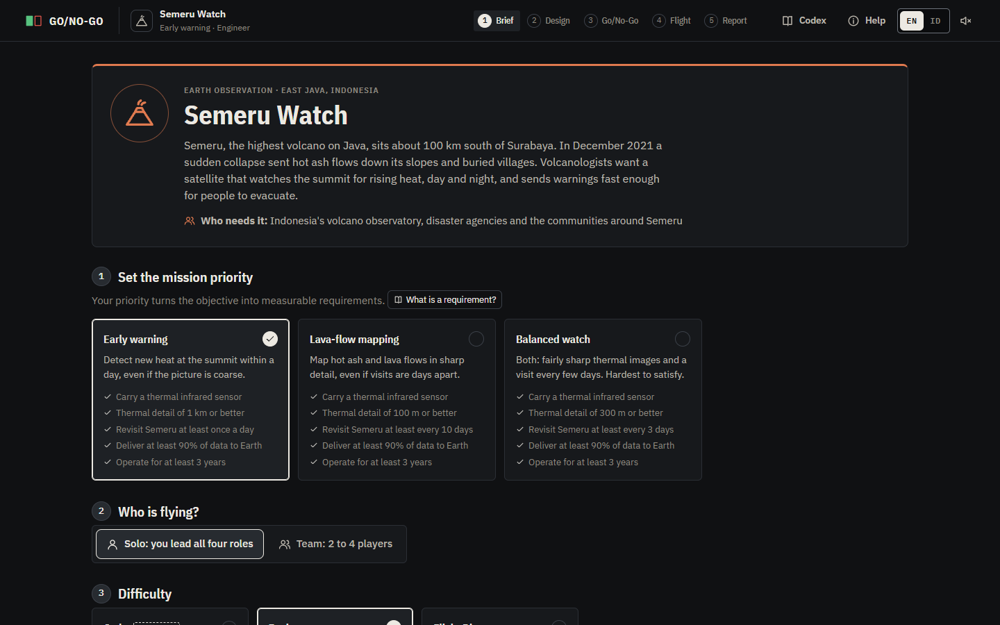
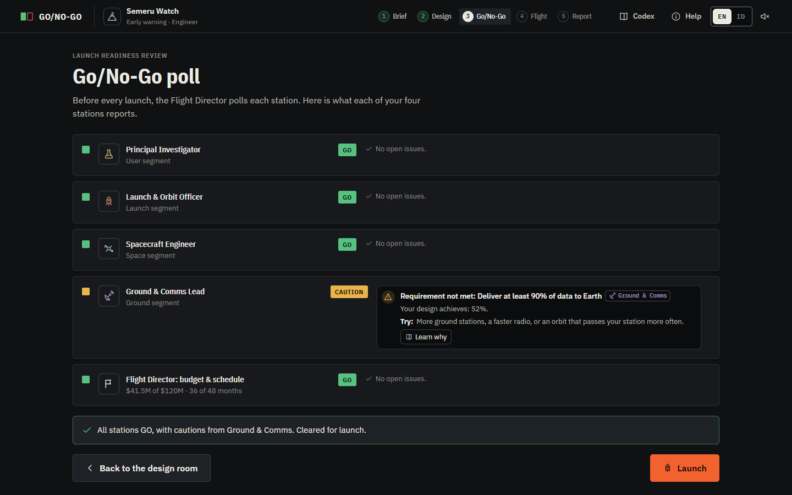

# GO/NO-GO

A space mission design game, made for the NASA Space Apps Challenge 2026 challenge
"Space Mission Design Game" (Surabaya local event).

You pick a real problem, design a spacecraft to solve it, hold a launch poll with your team,
and fly the mission. At the end the game tells you what went right, what went wrong, and why.

**Play it:** https://go-no-go-mission.vercel.app (no login, works in any modern browser)


## How a game works

1. **Brief.** Choose a mission and a priority. The priority turns the goal into requirements,
   for example "see the volcano at least once a day".
2. **Design.** Four roles build the mission: Science picks instruments, Orbit & Launch picks the
   orbit and rocket, Spacecraft builds the bus, and Ground & Comms gets the data home. Every
   choice changes mass, power, budget, data, comms, lifetime and delta-v, and the dashboard shows
   it right away. A 3D view shows the rocket you picked with your spacecraft inside its nose cone,
   so you can see at a glance whether the rocket can lift it.
3. **Go/No-Go.** Each role reports GO, CAUTION or NO-GO. In team mode every player votes.
4. **Flight.** Launch, reach orbit, and decide what to do when a solar storm, space debris or a
   broken reaction wheel shows up.
5. **Report.** A score, the cause of each problem, real NASA imagery of your target, and real
   missions that made similar choices.

| Mission brief | Design room |
|---|---|
|  |  |

| Go/No-Go poll | Launch |
|---|---|
|  |  |

| In orbit | Mission report |
|---|---|
|  |  |

## The missions

- **Semeru Watch:** watch Semeru volcano in East Java for new heat, day and night.
- **Archipelago Link:** relay messages from remote Indonesian islands on a tight budget.
- **Lunar Ice Hunter:** reach the Moon and map hydrogen in the polar craters.
- **Solar Sentinel:** sit at the Sun–Earth L1 point and warn Earth about solar storms.

Each mission has two or three priorities, so the same mission can call for very different
spacecraft. There is no single right answer.

## What else is in it

- Solo play, or a team of 2 to 4 players sharing one screen (or a screen share).
- Three difficulty levels. Cadet marks good options as "Suggested" for beginners.
- A guided tour on the first visit, and a Codex that explains 29 concepts in plain language.
- English and Bahasa Indonesia. English is the default.
- A 3D rocket in the design room: it changes with the launcher, the spacecraft parts and the
  fleet size, and turns red when the payload is too heavy. A flat schematic is one click away.
- A 3D flight view built with Three.js. If WebGL or the CDN is not available, the game falls back
  to 2D views.
- Sound effects made in code, including Apollo-style "Quindar" tones. There is a mute button.
- A link to share any design, and a local leaderboard.

## How the numbers work

The models are simple on purpose, so a game takes about 15 minutes, but they follow real physics:

- orbital period from Kepler's third law, and eclipse length from orbit geometry
- solar array size from the load plus battery recharge (the sizing method in *Space Mission
  Analysis and Design*)
- delta-v from the Tsiolkovsky rocket equation
- battery wear from how deeply each eclipse drains it
- revisit time from swath width and ground-track spacing

Component masses, power and costs are rounded game values that keep real-world proportions.
They are not engineering data.

## NASA data and resources

Used in the game:

- Earth texture: NASA Blue Marble, from NASA GIBS
- East Java image: Aqua MODIS true color, 20 July 2023, from NASA GIBS / Worldview
- Indonesia at night: NASA Black Marble (VIIRS), from NASA GIBS
- The Sun today: NASA SDO, AIA 193 Å (live image)
- Moon texture and map: NASA SVS CGI Moon Kit, made from LRO LROC data

The Earth and Moon textures are also stored in `assets/textures/`. The Moon copy is needed because
the SVS server does not allow its images to be used in WebGL from another website.

Resources that shaped the design:

- *Design and Develop Science Missions* (NASA): the four mission segments became the four roles.
- *Concept Maturity Levels* (NASA JPL): the path from objective to requirements to design review.
- *Mission Design Lab* (NASA GSFC): the list of subsystems and the idea of quick trade studies.
- *GMAT*: the same orbit physics, simplified.
- *CubeSat 101* (NASA CSLI): CubeSat sizes, rideshare launches and small-mission risks.
- *A Learning Game About Telescopes* (NASA Webb): showing similar real missions at the end.

Space agency partners mentioned in the game: ISRO (PSLV, NISAR, Aditya-L1), ESA (SOHO, SMART-1,
Ariane 6), JAXA (H3) and KASA (Danuri with NASA's ShadowCam). Indonesian missions LAPAN-A2 and
SATRIA-1 also appear.

## Run it locally

There is no build step and nothing to install. You only need Python (for the small dev server)
and, for the tests, Node 18 or newer.

```bash
python serve.py
```

Open http://localhost:5173. Opening `index.html` directly does not work, because browsers block
JavaScript modules on `file://`.

```bash
node tests/engine.test.js
```

The tests check the mission model, the flight simulation, scoring and the translations.

## Deploy

The site is hosted on Vercel (project `go-no-go-mission`) as plain static files.

- A push to `main` updates the live site. Pushes to other branches create preview links.
- To deploy by hand from this folder: `vercel --prod`.
- `.vercelignore` keeps tests, the dev server and screenshots off the live site.
- On the free plan a single upload can be up to 100 MB in total, so keep 3D models compressed.

## Project layout

```
index.html, styles.css   page shell and styles
src/main.js              screens, state and events
src/engine/              mission model, physics, flight simulation, scoring
src/data/                parts catalog, missions, events, Codex, Indonesian text
src/ui/                  screens, 3D and 2D flight views, schematic, tour, sound
assets/                  favicon and NASA textures
tests/                   engine tests
docs/screenshots/        images used in this README
```

## Use of AI

Much of the code and text, including the Bahasa Indonesia translation, was written with help
from an AI coding assistant (Claude), then reviewed, tested and edited by the team. The game has
no AI-generated images, audio or video: the pictures come from NASA and the sounds are generated
by code.
