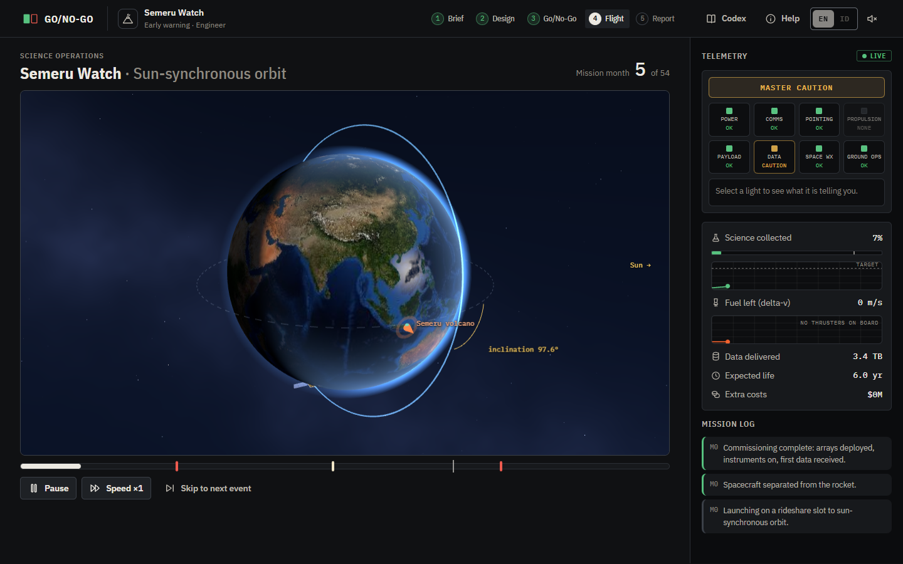
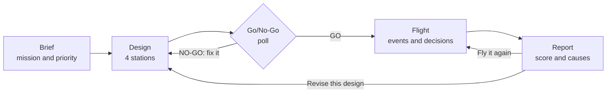
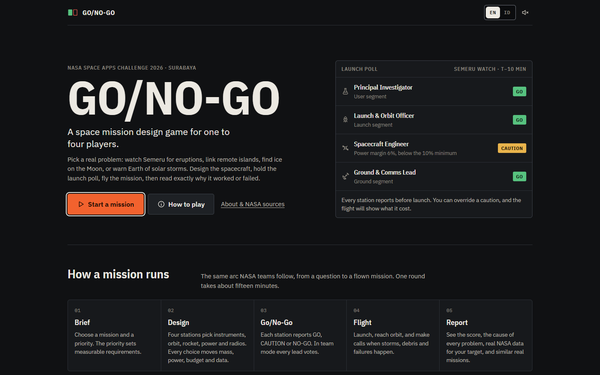
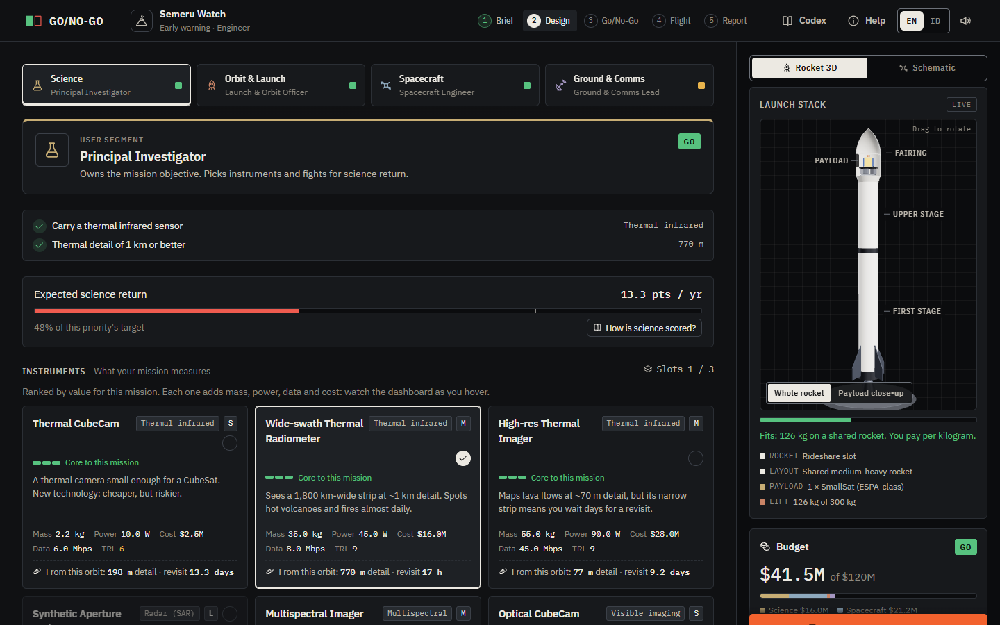
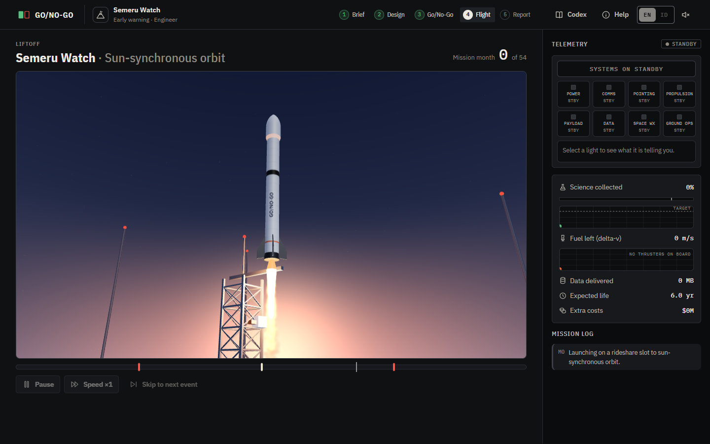
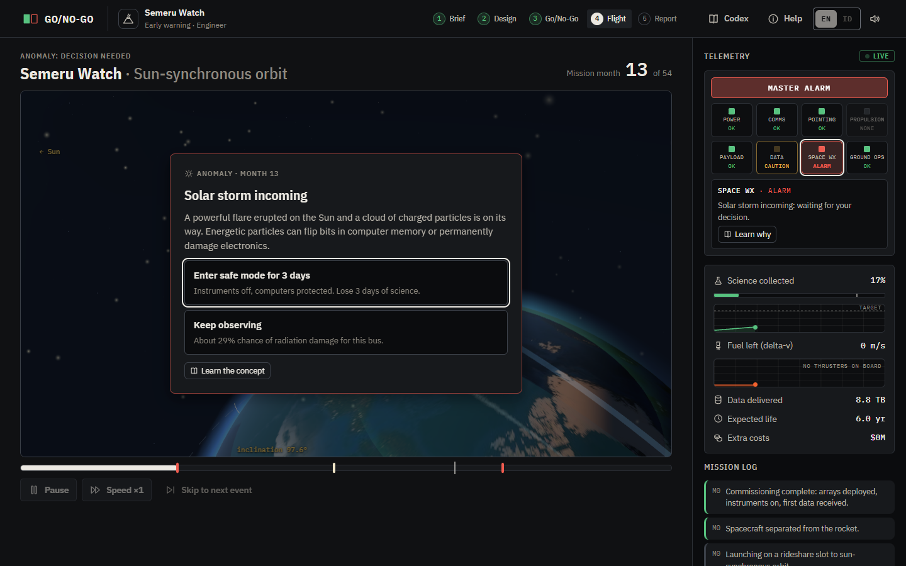
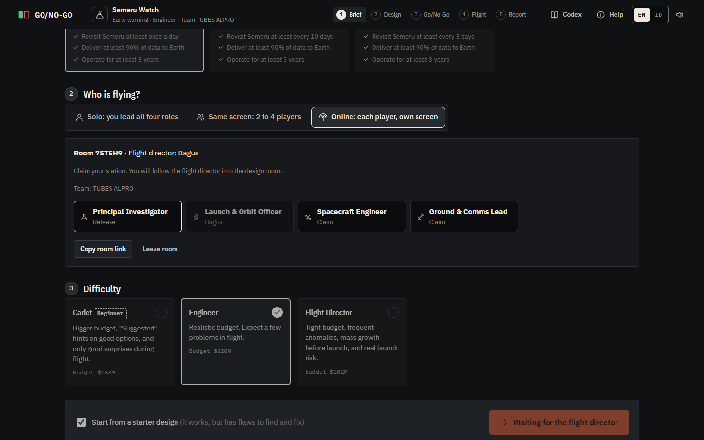
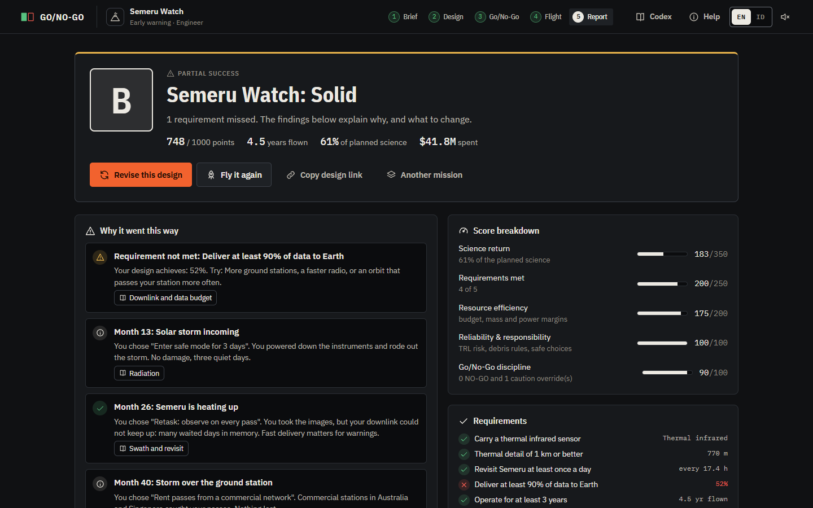

# GO/NO-GO: Space Mission Design Game

**Design a spacecraft, win the launch poll, fly the mission, and find out why it worked or failed.**

By team **TUBES ALPRO** (Bagus Ardin Prayoga and Ida Bagus Krisnabhawa) for the 2026 NASA Space
Apps Challenge, challenge
[*Space Mission Design Game*](https://www.spaceappschallenge.org/2026/challenges/space-mission-design-game/)
(Surabaya local event).

[](https://go-no-go-mission.vercel.app)

<!-- DEMO LINK: when the demo is ready, replace the "Demo" line below with this badge and put the
     link in place of DEMO_URL:
[](DEMO_URL)
-->
**Demo (7 slides or a 30-second video):** link coming soon

1 to 4 players · no login, no install · works offline after the first visit ·
English and Bahasa Indonesia · built on NASA data



*Semeru Watch in orbit. Every pass paints the ground track (thin lines) and the strip the thermal
camera can see (wide bands) onto a NASA Blue Marble Earth, and the label counts how many times
Semeru has been imaged.*

## Try it in 5 minutes

1. Open **https://go-no-go-mission.vercel.app** and press **Start a mission**.
2. Choose **Semeru Watch** and the **Cadet** level. Cadet marks good parts as *Suggested*, so
   anyone can build a working spacecraft without a background in engineering.
3. Change a part and watch the dashboard: mass, power, budget, data, comms, lifetime and delta-v
   all update at once.
4. Hold the **Go/No-Go** poll, launch, and make a call when something goes wrong in orbit.
5. Read the **report**: your score, the cause of every problem, real NASA imagery of Semeru, and
   real missions that made similar choices. Press **Revise this design** and try to beat it.

To play as a team on separate screens, choose **Online: each player, own screen** on the mission
brief and press **Create a room**. Teammates press **Join a room** on the home screen and type the
six-letter code. Each player claims one of the four stations.

## The game loop



1. **Brief.** Choose a mission and a priority. The priority turns the goal into measurable
   requirements, for example "see the volcano at least once a day".
2. **Design.** Four stations build the mission. Science picks instruments, Orbit & Launch picks
   the orbit and rocket, Spacecraft builds the bus, and Ground & Comms gets the data home. A 3D
   view shows your spacecraft inside the rocket's nose cone and turns red if the rocket cannot
   lift it.
3. **Go/No-Go.** Each station reports GO, CAUTION or NO-GO from its own numbers. In team mode,
   every player votes and the rocket waits for four GOs.
4. **Flight.** Launch, reach orbit, and decide what to do when a solar storm, space debris or a
   broken reaction wheel shows up. The 3D view plays each event (debris closing in, an ash plume
   over Semeru, auroras, a CME heading for Earth) and the result of your decision. It paints the
   ground track and the instrument's swath onto Earth, so you can see how often you pass over the
   target.
5. **Report.** A score out of 1,000, the cause of each problem in plain language, real NASA
   imagery of your target, and real missions that made similar choices.

## Why we built it

It started with a question we could not answer: what has to happen before a rocket is allowed
to launch? Who decides, which parts does a spacecraft need, and why do some missions fail before
they leave the ground?

We came to this as learners, not experts. Building the game was how we studied it, and we tried
to turn what we learned into something other beginners can play. That is why every warning in
the game explains its reason, why there is a Codex in plain language, and why the report tells
you what went wrong instead of only giving a score.

## Why it matters

The challenge names a real gap: students learn orbits, rockets and spacecraft one topic at a
time, and rarely see how a mission team makes decisions that pull against each other. In
GO/NO-GO a better camera means more mass, more power, more data and a higher bill, and the
player feels each of those right away.

- **Learn by failing safely.** A failed mission is the most useful result: the report names the
  cause and links it to a Codex entry, and *Revise this design* takes you straight back.
- **Short enough for a lesson.** A game takes about 15 minutes, so a class can design, fail, fix
  and fly again in one session.
- **Close to home.** Two of the four missions are set in Indonesia. Semeru, the highest volcano
  on Java, sits about 100 km south of Surabaya, and in December 2021 a sudden collapse sent hot
  ash flows over nearby villages. Many fishing villages and remote islands still have no mobile
  signal. The whole game is also in Bahasa Indonesia, so students here can play in their own
  language.
- **Easy to reach.** It is free and needs no account or install. After the first visit it keeps
  working when the network drops, which matters on school and event Wi-Fi.

## How it answers the challenge

| The challenge asks for | What GO/NO-GO does |
|---|---|
| Define a mission objective and requirements | 4 missions with 9 priorities in total. Each priority turns the goal into measurable requirements. |
| Design a spacecraft and choose instruments | 62 options in 11 categories: 17 instruments, 4 bus sizes, solar arrays, batteries, attitude control, propulsion, radios, ground networks and ops teams. |
| Choose a launch vehicle and orbit, and check they fit | 7 orbits and 5 launch vehicles. The game checks mass and orbit class against the rocket, and the 3D rocket turns red when it is too heavy. |
| Manage budget, mass, power, data, comms and lifetime | A live dashboard with margins. 10 to 45% margin is the healthy zone: too little is risky, too much wastes mass and money. |
| Show how one decision affects the rest | Every change updates every number at once, and each station's GO/NO-GO status changes with it. |
| Show there is no single right answer | Each mission has 2 or 3 priorities that call for very different spacecraft. |
| Team play for up to 4, with different roles | 4 stations based on NASA's mission segments. In an online room each player can only change their own station, so the team has to negotiate. |
| Random events and constraints | 12 flight events (8 problems, 4 opportunities), each tied to a real engineering concept. |
| Difficulty levels | Cadet (hints, larger budget, 1 event), Engineer (3 events, failures), Flight Director (tight budget, 5 events, mass growth before launch, real launch risk). |
| A score that rewards good engineering | Science return, requirements, resource efficiency, reliability and teamwork (see below). |
| A report and post-mission analysis | The cause of every problem, real NASA imagery and 17 real missions to compare with. |
| Simulate more than once | *Revise this design* and *Fly it again*. |
| Save, share and compare designs | A link for any design, and a leaderboard for each priority. |
| Explain concepts simply | A guided tour, warnings that explain their reason, and a Codex of 29 concepts. |
| Interactive spacecraft visuals | A 3D rocket and spacecraft, a flat schematic, and a 3D flight with ground track and swath. |

## What makes it different

- **The launch poll is the heart of the game.** Real launches wait until every console says
  "go". Here each station judges the design from its own numbers. Overriding a NO-GO in solo play
  costs points, and a team cannot launch without four GO votes.
- **Every player owns a real mission segment.** The four stations come from NASA's *Design and
  Develop Science Missions*. The scientist wants a bigger instrument, the spacecraft lead has no
  power to spare, and the team has to agree before the rocket can fly.
- **Real places, real stakes.** An active volcano in East Java, islands without a phone signal,
  ice hidden in lunar polar craters, and solar storms seen from the Sun–Earth L1 point.
- **You see your orbit, not just numbers.** The ground track and the instrument swath are drawn
  on a NASA Blue Marble Earth, so a revisit time becomes something you can see.
- **It ends with real missions.** The report compares your design with 17 missions from NASA,
  ISRO, ESA, KASA, NOAA and Indonesia, such as Terra and Aqua, NISAR, LRO, SOHO, Aditya-L1 and
  LAPAN-A2.
- **It sounds like mission control.** Sound effects are made in code, including Apollo-style
  "Quindar" tones.

## The missions

| Mission | Goal | Priorities |
|---|---|---|
| **Semeru Watch** | Watch Semeru volcano in East Java for new heat, day and night. | warning, mapping, balanced |
| **Archipelago Link** | Relay messages from remote Indonesian islands on a tight budget. | messaging, fisheries |
| **Lunar Ice Hunter** | Reach the Moon and map hydrogen in the polar craters. | ice, landing |
| **Solar Sentinel** | Sit at the Sun–Earth L1 point and warn Earth about solar storms. | warning, imaging |

## Built on real physics

The models are simple on purpose, so a game takes about 15 minutes, but they follow real physics:

- orbital period from Kepler's third law, and eclipse length from orbit geometry
- solar array size from the load plus battery recharge (the sizing method in *Space Mission
  Analysis and Design*)
- delta-v and propellant from the Tsiolkovsky rocket equation
- battery wear from how deeply each eclipse drains it
- revisit time from swath width and ground-track spacing

Component masses, power and costs are rounded game values that keep real-world proportions.
They are not engineering data.

**Scoring (1,000 points)**

| Part | Points | What it rewards |
|---|---:|---|
| Science return | 350 | The share of the planned science delivered, with a bonus for doing better |
| Requirements met | 250 | Each mission requirement that passes |
| Resource efficiency | 200 | Staying on budget, and mass and power margins in the healthy zone |
| Reliability and responsibility | 100 | Technology readiness risk, space debris rules, safe choices |
| Teamwork | 100 | Team: each station's own goal. Solo: not overriding NO-GO and CAUTION calls |

Grades: **S** 900+, **A** 760+, **B** 600+, **C** 450+, **D** below 450.

**Tested.** 31 automated tests cover the mission model, the flight simulation, scoring, both
languages and the online room rules. One test checks that every Cadet *Suggested* design really
meets every requirement.

## NASA data and resources

NASA data is part of the game itself, not decoration:

| NASA data | Where it appears |
|---|---|
| **Blue Marble** (NASA GIBS) | The 3D Earth that your orbit, ground track and swath are drawn on |
| **Aqua MODIS** true color, 20 July 2023 (NASA GIBS / Worldview) | Semeru Watch: East Java from orbit |
| **Black Marble**, Suomi NPP VIIRS (NASA GIBS) | Archipelago Link: Indonesia at night, showing which islands stay dark |
| **SDO AIA 193 Å** (live image) | Solar Sentinel: the Sun as it looks today |
| **LRO LROC** via the NASA SVS CGI Moon Kit | Lunar Ice Hunter: the 3D Moon and the polar map |

The Earth and Moon textures are also stored in `assets/textures/`. The Moon copy is needed because
the SVS server does not allow its images to be used in WebGL from another website.

NASA resources that shaped the design:

- *Design and Develop Science Missions* (NASA): the four mission segments became the four stations.
- *Concept Maturity Levels* (NASA JPL): the path from objective to requirements to design review.
- *Mission Design Lab* (NASA GSFC): the list of subsystems and the idea of quick trade studies.
- *GMAT* (NASA GSFC): the same orbit physics, simplified.
- *CubeSat 101* (NASA CSLI): CubeSat sizes, rideshare launches and small-mission risks.
- *A Learning Game About Telescopes* (NASA Webb): showing similar real missions at the end.

Space agency partners in the game: ISRO (PSLV, NISAR, Aditya-L1), ESA (SOHO, SMART-1,
Ariane 6), JAXA (H3) and KASA (Danuri with NASA's ShadowCam). The Indonesian missions LAPAN-A2
and SATRIA-1 also appear.

## Screenshots

| Home | Mission brief |
|---|---|
|  |  |

| Design room | Go/No-Go poll |
|---|---|
|  |  |

| Launch | An anomaly in flight |
|---|---|
|  |  |

| Online team room | Mission report |
|---|---|
|  |  |

## How it is built

- Plain HTML, CSS and JavaScript modules. No framework, no build step and no server of our own.
- **3D:** Three.js r160, with 2D views as a fallback when WebGL is not available.
- **Online rooms:** a small MQTT client over WebSocket, using the public HiveMQ and EMQX brokers.
  The brokers only carry room messages. The room code is the only lock, so treat it like a
  password.
- **Offline:** a service worker keeps a copy of every file. It is network-first, so while online
  you always get the newest version.
- **Accessibility:** keyboard skip link, screen reader labels, and calmer motion when the system
  asks for reduced motion.

### Run it locally

There is no build step and nothing to install. You only need Python (for the small dev server)
and, for the tests, Node 18 or newer.

```bash
python serve.py              # then open http://localhost:5173
node tests/engine.test.js    # run the tests
```

Opening `index.html` directly does not work, because browsers block JavaScript modules on
`file://`.

### Deploy

The site is hosted on Vercel (project `go-no-go-mission`) as plain static files.

- A push to `main` updates the live site. Pushes to other branches create preview links.
- To deploy by hand from this folder: `vercel --prod`.
- `.vercelignore` keeps tests, the dev server and screenshots off the live site.
- When you release a new version, raise `VERSION` in `sw.js` so old offline copies are dropped.

### Project layout

```
index.html, styles.css   page shell and styles
sw.js, src/offline.js    offline support (service worker)
src/main.js              screens, state and events
src/engine/              mission model, physics, flight simulation, scoring
src/data/                parts catalog, missions, events, Codex, Indonesian text
src/net/                 online rooms (MQTT client and room rules)
src/ui/                  screens, 3D and 2D flight views, schematic, tour, sound
assets/                  favicon, NASA textures, fonts and Three.js (so it works offline)
tests/                   engine tests
docs/screenshots/        images used in this README
```

## Limits and next steps

We kept the scope honest:

- The models are simplified for a 15-minute game and are not engineering tools.
- The leaderboard is stored in each browser, not shared online.
- Online rooms depend on free public brokers, and there are no accounts.

Next we would like to add a classroom mode for teachers, a sandbox with no budget limit,
competitive rounds where several teams solve the same mission, and more missions.

## Team

**TUBES ALPRO**, NASA Space Apps Challenge 2026, Surabaya local event

- Bagus Ardin Prayoga
- Ida Bagus Krisnabhawa

## Credits

- **NASA data and resources:** listed above.
- **Three.js** r160 (MIT License): bundled in `assets/vendor/`, with unpkg and jsDelivr as
  fallbacks.
- **IBM Plex** Sans, Sans Condensed and Mono (SIL Open Font License 1.1): bundled in
  `assets/fonts/`, license in `assets/fonts/OFL.txt`.
- **HiveMQ** and **EMQX** public MQTT brokers: carry the online room messages.
- **Book:** J. R. Wertz and W. J. Larson (eds.), *Space Mission Analysis and Design*: the solar
  array and battery sizing method.

## Use of AI

The starting idea and the goal are ours: a game that teaches how a space mission is prepared,
made by people who wanted to learn it themselves. We used an AI coding assistant (Claude, by
Anthropic) to build it faster than a two-person team could in one weekend.

What the AI did:

- suggested options while we shaped the game concept
- wrote most of the code, the in-game text and the Bahasa Indonesia translation
- wrote the tests and helped find and fix bugs

What we did:

- chose the challenge, the goal and what the game should teach
- decided which ideas and features to keep, add or remove
- reviewed each version and asked for changes
- learned how real missions work along the way, which was the point

The game has no AI-generated images, audio or video: the pictures come from NASA and the sounds
are generated by code. The screenshots in this README are captured from the game itself. The
same note is in the site's metadata (`index.html`) and in `package.json`.

## License

Our code and text are released under the [MIT License](LICENSE). Bundled third-party files keep
their own licenses: Three.js (MIT) and the IBM Plex fonts (SIL Open Font License 1.1). NASA
imagery is courtesy of NASA and is used under NASA's media usage guidelines.
